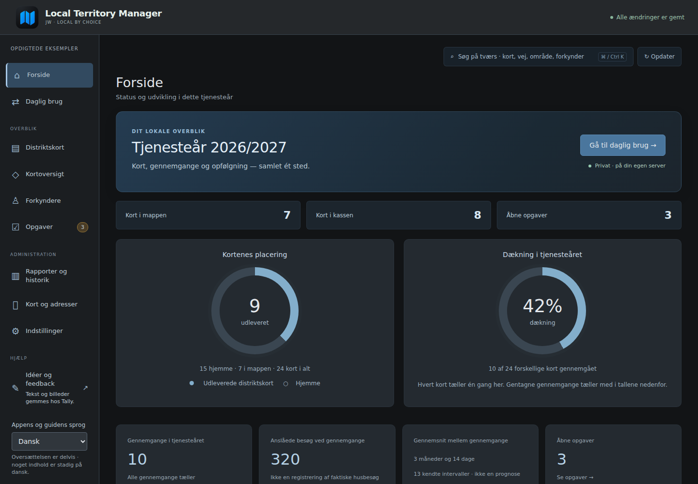
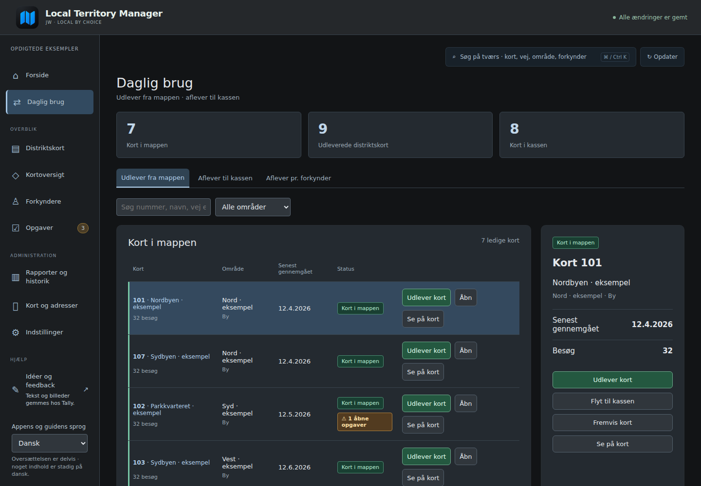
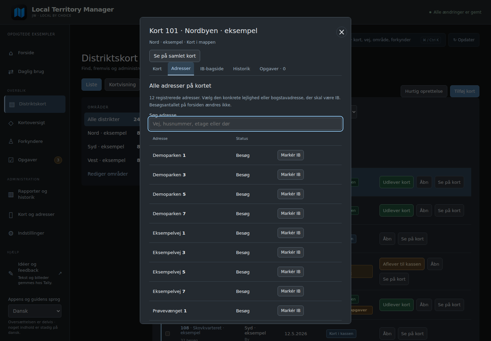

<picture>
  <source media="(prefers-color-scheme: dark)" srcset="assets/brand/logo-dark.svg">
  
</picture>

# Your territory cards. One clear overview.

**Keep track of territory cards, assignments and completed work, with your records on your own system.**

LTM is a free, unofficial tool for territory administration in congregations of Jehovah’s Witnesses. Find an available card, record an assignment or return, and keep its history together. Start with your existing paper cards and add addresses and maps when you are ready.

**[Try the demo](https://bib007.github.io/LTM-Local-Territory-Manager/) · [Get started](docs/INSTALL.en.md) · [Ideas and feedback](https://tally.so/r/KpY0ZV)**

The demo uses fictional examples and needs no installation or account. The feedback form is currently in Danish.

## Everyday work, made clearer

- See cards that are assigned, in the carry folder or in the storage box.
- Record assignments and returns, and find each card’s history.
- Start with card numbers, or bring an existing list from Excel.
- Draw boundaries, select addresses and use a shared map overview.
- Print card fronts, do-not-call backs, S-13 and summaries.
- Keep notes and follow-up tasks with your cards.

## A look inside

These pictures show the application with fictional examples. Danish is the main language; English can be selected, although some text and the original forms remain Danish.

## Choose where to use LTM

**Latest stable version: 1.12.1**

- **Home Assistant:** add LTM and install **Distrikt**. Open the same installation from your computer, phone or iPad on your home network.
- **Mac or Windows:** [download the program](https://github.com/Bib007/LTM-Local-Territory-Manager/releases/latest), extract it and follow the [installation guide](docs/INSTALL.en.md). Install Python once if it is not already available.

[Add to Home Assistant](https://my.home-assistant.io/redirect/supervisor_add_addon_repository/?repository_url=https%3A%2F%2Fgithub.com%2FBib007%2FLTM-Local-Territory-Manager) · [Your first session](docs/FIRST-STEPS.en.md)

Already using LTM? Download a private backup inside the app before updating. A beta installation has separate records; these are not automatically moved into the stable app.

## Your records stay with you

Cards, publishers, do-not-call records, assignments and notes are stored on the computer or Home Assistant running LTM. No LTM account or subscription is required, and the app does not send usage statistics to its developer.

Map backgrounds, address searches and optional Google Drive sharing use the internet. You may choose to share a reviewed card image using a QR code. This does not upload databases, publisher records, do-not-call lists or assignment history. Anyone with an open image link can view and forward the image.

**Use LTM’s own backup feature. Home Assistant’s ordinary backup does not include LTM’s records.**

[Privacy and sharing](docs/PRIVACY.en.md) · [Updating and moving your records](docs/INSTALL.en.md)

## Before you start

**Do I need to enter every paper card first?** No. Begin with card numbers and existing assignments; add addresses and maps later.

**Do I need Home Assistant?** No. Mac and Windows are also supported.

**Can I use my phone away from home?** Yes, using your own VPN connection to your home network. See the installation guide.

**Can I bring existing records?** You can import cards from Excel and supported S-13 records. Review and approve the results before they are saved.

## Ideas and feedback

[Send feedback](https://tally.so/r/KpY0ZV) without an account or email address. The form accepts pictures and currently uses Danish. Submit fictional examples only, without private records, real do-not-call details, backups or passwords. Your submitted text and pictures are stored by Tally.

## About LTM

LTM is an unofficial project, not produced or approved by Jehovah’s Witnesses, jw.org, JW HUB or Home Assistant. It is developed with help from OpenAI Codex. [License](LICENSE) · [Third-party notices](distrikt/THIRD-PARTY.md).

[Dansk](README.md) · [Known limitations](docs/LIMITATIONS.en.md) · [Contributing](docs/CONTRIBUTING.en.md)
