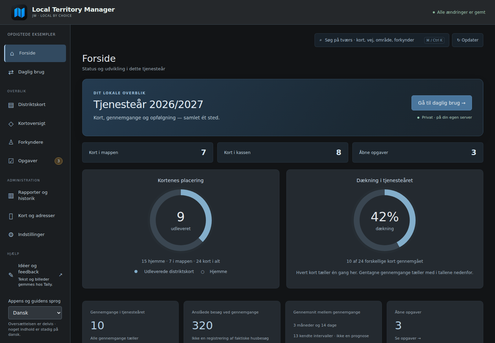
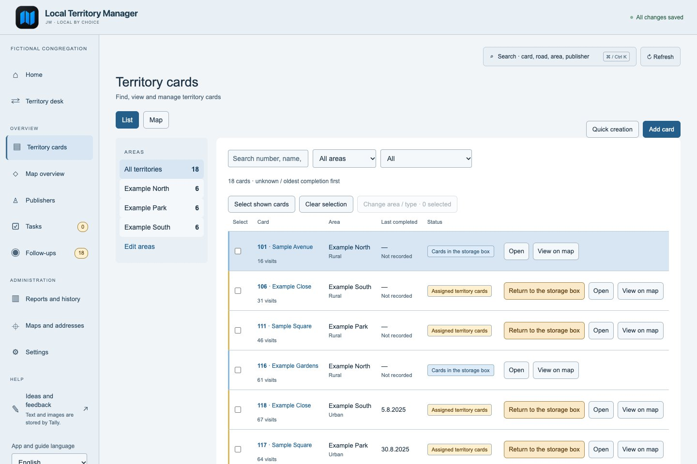
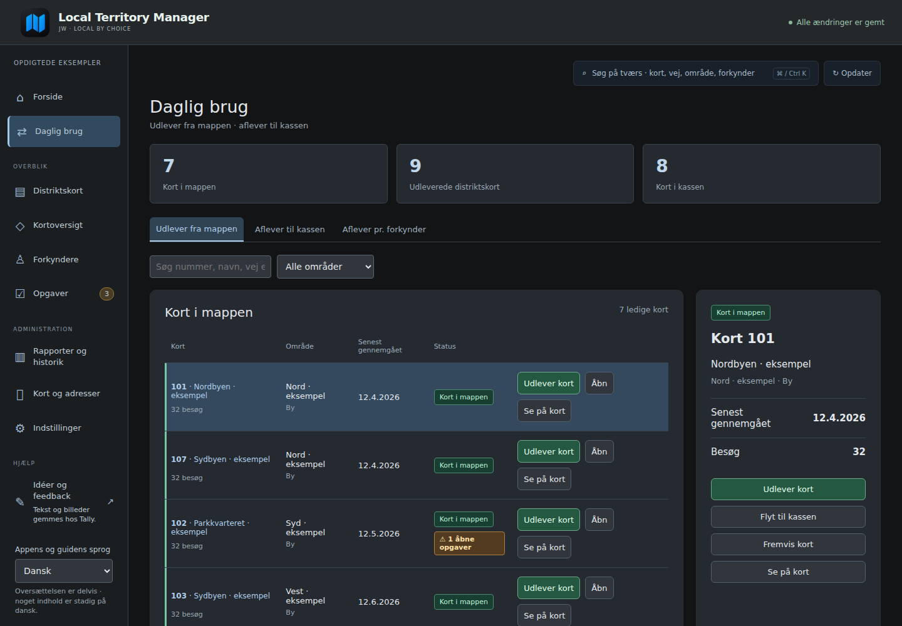
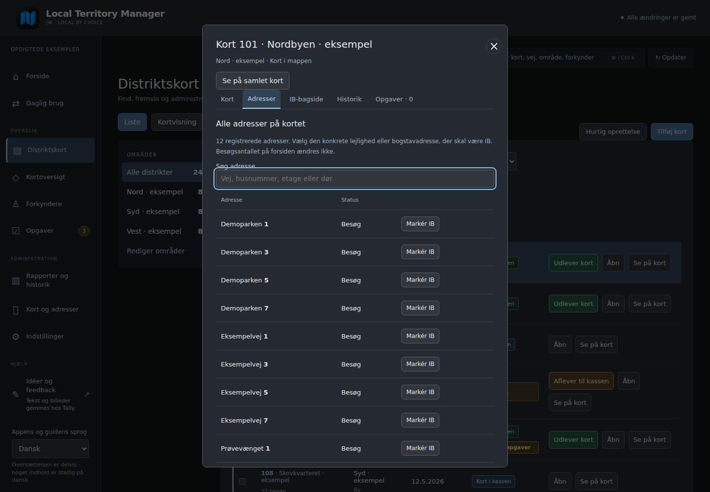
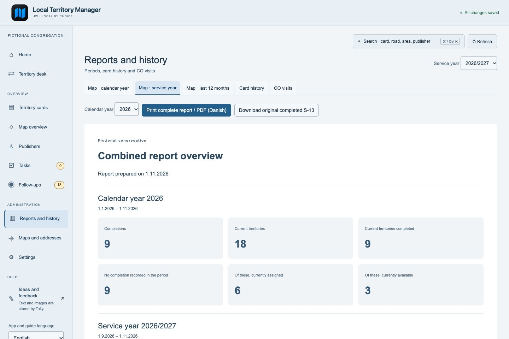

<picture>
  <source media="(prefers-color-scheme: dark)" srcset="assets/brand/logo-dark.svg">
  
</picture>

# Your territory cards. One clear overview.

**Less time keeping track. More clarity in the daily work.**

A free, self-hosted territory manager for congregations of Jehovah’s Witnesses. 
Cards, assignments, returns and history — together on your own system.

**[▶ Try the live demo](https://bib007.github.io/LTM-Local-Territory-Manager/) · [Get started](docs/INSTALL.en.md) · [Visit the website](https://localterritorymanager.netlify.app/)**

[Latest stable release](https://github.com/Bib007/LTM-Local-Territory-Manager/releases/latest) · [What’s new](docs/RELEASE-NOTES.md) · [Dansk vejledning](docs/INSTALL.md)

**Free & open source · Mac, Windows & Linux · Home Assistant · No subscription**

*The familiar home dashboard, shown in Danish with fictional records. English and Danish are available; the app also supports light and dark appearance.*

## Start with the cards you already have

You do not need to draw every boundary or enter every address before LTM becomes useful. Start with your existing card numbers and assignments. Add street lists, addresses and map drawing at your own pace.

| Keep the daily work simple | Bring your own information | Work together |
| --- | --- | --- |
| Find an available card, record an assignment and return it to the storage box. Keep the history in one place. | Import supported Excel or CSV files, choose the columns, review the result and confirm. | Create individual accounts, choose your own roles and give each user a guided introduction suited to their access. |

## See LTM in use

These screenshots show the actual application with **fictional example records**. The home dashboard and reports have their own views; the gallery includes English and Danish examples.

### Find the right card

See which cards are in the carry folder, in storage or currently assigned. Search and filter the list, open a card and keep its status close at hand.

### Assign and return, without losing the history

A dedicated territory desk brings everyday assignments and returns together. Select a card and publisher, record a return and add a note when needed.

### Keep card details together

Add addresses and boundaries when you are ready. Manual street and number ranges can stay on a card without inventing geography or guessing how many visits they represent.

### See the bigger picture

Compare calendar-year, service-year and rolling-12-month summaries. See current assignments and territories without a recorded completion in the period, then print the report when needed.

## More than a card list

- **Your own Excel files.** Card and do-not-call imports support sheet, header-row and column selection. Review the normal validation preview before approving. Both fronts and do-not-call backs work without DAR; manual entries can be linked to an address later. Supported publisher and history imports have their own reviewed workflows.
- **Dates you actually know.** Import or enter a do-not-call entry with `March 2024` or just `2024`; the missing day or month is never invented.
- **Street lines into map suggestions.** Confirm postcodes, download Danish DAR addresses for existing street names/ranges, inspect the proposed boundary and save explicitly. [How it works](docs/STREET-SUGGESTIONS.en.md).
- **Your own roles.** Grant home and report-summary access separately from detailed cards, personal records and administration. Each user’s personal guide follows their current permissions; administrators can schedule it for the next login.
- **Clearer shared editing.** Independent field edits can be combined, while conflicting saved proposals stay available for review. Unknown save results are checked before repeating a write.
- **Useful printing.** Produce card fronts, do-not-call backs, the original S-13 and report summaries. Original printed forms remain unchanged.
- **Notes and follow-ups.** Keep the next task close to the relevant card, with a separate place for follow-ups and checks.
- **Optional QR images.** Approve a public card-front image for Google Drive. Where supported, retain the same file and QR link; automatic date updates need their own approval. This supports the physical card workflow.
- **Private backups.** Keep territory-data backups and separate account backups, with explicit validation and a safety copy during restore.

English is the default for new users; Danish and saved language preferences are preserved. The interface is available in English and Danish. Original S-12/S-13 forms and stored user content keep their language; external technical diagnostics may retain the source language.

## Try both sides of the desk

**[Open the interactive demo →](https://bib007.github.io/LTM-Local-Territory-Manager/)**

| Administrator example | Territory-desk assistant example |
| --- | --- |
| Explore the wider application: cards, publishers, tasks, reports and settings. | Explore the allowed overview, assign and return cards, add a return note and view the permitted report summary. |

No installation or account is needed. The demo uses fictional records and browser-local state. It is a simulation, separate from your installed server; its role switch is not authentication. Use invented examples only.

## Choose an installation

| Option | Start here | Requirements |
| --- | --- | --- |
| Home Assistant | [Install the stable add-on](docs/INSTALL.en.md#home-assistant-os) | Your own Home Assistant system; ordinary stable port 8787 |
| Windows, macOS or Linux | [Computer setup](docs/SELF-HOSTING.en.md) | Python 3.9+ with SQLite; extract the complete release ZIP |
| Separate beta | [Beta installation](docs/BETA.md) and [prereleases](https://github.com/Bib007/LTM-Local-Territory-Manager/releases) | Separate test data/login; HA beta port 8788 |

Use [the latest stable release](https://github.com/Bib007/LTM-Local-Territory-Manager/releases/latest) for ordinary work. GitHub's latest link excludes prereleases; use the release list for betas. Native EXE/DMG installers are not currently supplied.

For a new computer installation, run the platform's **Start-LTM** launcher from the extracted `Distrikt-lokal` directory. Existing installations should follow the update guide and keep using the same data directory. Keep the previous program folder until the new version has been checked. Do not point a separate beta at production data.

## Accounts, access and private records

The installed server enforces each account's current permissions; hiding a button is not its security boundary. The administrator chooses users and roles in the application. See [accounts, roles and introductions](docs/USERS.en.md).

LTM stores its databases in the selected installation's data directory. Restrict server access to your private network and use your own VPN for remote access. Do not expose the application directly to the public internet. [Home Assistant security](docs/HA-SECURITY.en.md) explains its deployment limits.

Map tiles, address services and optional Drive publication contact external providers. Automatic address integrations currently focus on Danish source data; manual cards and core administration do not require Danish automatic address lookup. Read [privacy](docs/PRIVACY.en.md), [current limitations](docs/LIMITATIONS.en.md) and [Google Drive sharing](docs/GOOGLE-DRIVE.en.md) before relying on those features.

## Back up before updating

1. Download a private territory-data backup from the app.
2. If profiles are enabled, also keep a separate account backup. An ordinary data ZIP does not replace account recovery material or connection configuration.
3. Update the program while preserving the installation's data directory.
4. Open the updated app and check the records. Keep backups away from public repositories, the website, feedback forms and public Drive images.

Original printing templates and existing records are preserved by ordinary updates. Imported public-image metadata does not resume external publication automatically; approve a new image after restore.

## A few questions before you start

<strong>Do all my paper cards need to be entered first?</strong>

No. Start with the card numbers and assignments you already have. Addresses, street lists and boundaries can follow later.

<strong>Do I need Home Assistant?</strong>

No. You can also run LTM on a Windows, Mac or Linux computer with Python. The installation guides cover both options.

<strong>Can I use a phone or iPad?</strong>

Yes. Open the same installation over your private network. Use your own VPN when connecting remotely. Your phone is a client of that installation; LTM is not a hosted cloud service.

<strong>Can I use my own Excel layout?</strong>

Yes, for supported card and do-not-call imports: upload an XLSX or CSV file, select the sheet and header row, map your columns, then review and confirm. LTM does not guess missing geography or visit totals.

## Documentation and feedback

[Documentation overview](docs/README.en.md) · [First steps](docs/FIRST-STEPS.en.md) · [Accounts and roles](docs/USERS.en.md) · [Printing](docs/PRINT.en.md) · [Privacy](docs/PRIVACY.en.md) · [Contributing](docs/CONTRIBUTING.en.md)

[Report a bug or suggest an improvement](https://tally.so/r/KpY0ZV). Describe the steps and include invented examples. Never submit real names, do-not-call records, private databases, passwords or connection files. The feedback form is operated separately by Tally.

LTM is an independent, unofficial open-source project. It is not developed, published or endorsed by Jehovah’s Witnesses or their organisation. No official affiliation is implied.
